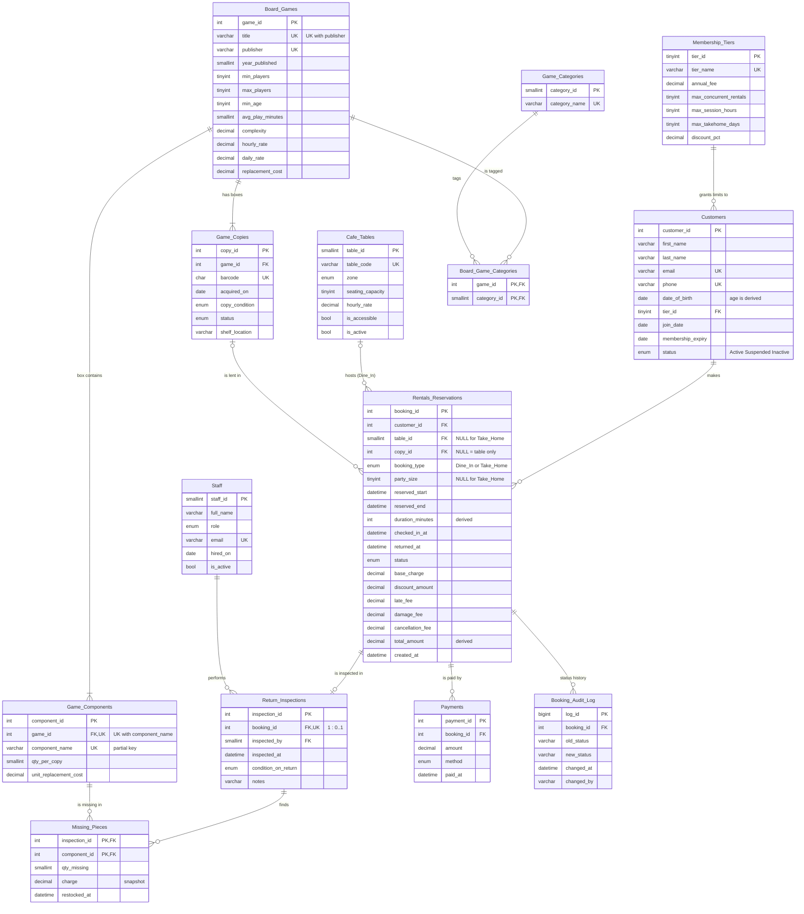

# ER diagram

Two views of the same design:

1. a **crow's-foot diagram** of the 14 implemented tables (also rendered as [`ER_diagram.png`](ER_diagram.png); Mermaid — GitHub, VS Code and most
   Markdown viewers render it; or paste it into <https://mermaid.live>), and
2. instructions for drawing the **Chen-notation** conceptual model in ERDplus or Dia, which is the
   form the lab (Experiment 1) and the theory exam expect.

## 1. Crow's-foot diagram (implemented schema)

Types are abbreviated (`decimal` = `DECIMAL(p,s)`, `enum` = `ENUM(...)`); see
[`data_dictionary.md`](data_dictionary.md) for exact types. `PK` primary key, `FK` foreign key,
`UK` unique (alternate key). Generated (derived) columns are marked "derived".

### Reading the cardinalities

| Relationship | Cardinality | How it is implemented |
| --- | --- | --- |
| Tier — Customer | 1 : N, every customer has exactly one tier | `Customers.tier_id` NOT NULL FK |
| Customer — Booking | 1 : N | `Rentals_Reservations.customer_id` NOT NULL FK |
| Table — Booking | 0..1 : N (Take_Home has no table) | nullable FK `table_id`, required for Dine_In by `chk_booking_type_shape` |
| Copy — Booking | 0..1 : N (a Dine_In may be "table only") | nullable FK `copy_id`, required for Take_Home |
| Game — Copy | 1 : N | `Game_Copies.game_id` NOT NULL FK |
| Game — Component | 1 : N, identifying (weak entity) | `Game_Components.game_id` FK + `UNIQUE (game_id, component_name)` |
| Game — Category | M : N | bridge `Board_Game_Categories` with composite PK |
| Booking — Inspection | 1 : 0..1 | `Return_Inspections.booking_id` UNIQUE FK |
| Inspection — Component | M : N with attributes (qty, charge, restocked_at) | `Missing_Pieces` with composite PK |
| Booking — Payment | 1 : N (part payments allowed) | `Payments.booking_id` FK |

## 2. The student's original design and the two renamed entities

The proposal named four core entities; they are still the centre of the schema:

| Proposal | Implemented as | Why the name changed |
| --- | --- | --- |
| `Customers` (members) | `Customers` | — |
| `Board_Games` (age restriction, player count, condition) | `Board_Games` + `Game_Copies` | **Condition** describes one physical box, not the title: two boxes of Catan can be in different states. Keeping it on `Board_Games` would make `condition` depend on something other than the key `game_id` (it depends on the box), i.e. a normalization error; and `CONDITION` is a reserved word in MySQL. So condition moved to `Game_Copies.copy_condition`. |
| `Tables` (zones with maximum seating) | `Cafe_Tables` | `TABLES` is a reserved word in MySQL (`SHOW TABLES`, `LOCK TABLES`). It would have to be back-quoted everywhere. |
| `Rentals_&_Reservations` (who rented what game, at which table, for how long) | `Rentals_Reservations` | `&` is not allowed in an unquoted identifier. |

## 3. Drawing the Chen-notation diagram (ERDplus or Dia)

ERDplus (<https://erdplus.com>, free, browser) has every Chen symbol; Dia has them under the
"ER" sheet. Draw the **conceptual** model, not the tables: relationships are diamonds, not bridge
tables.

### 3.1 Strong entities (single rectangle) and their attributes (ovals)

| Entity | Key (underlined) | Other attributes | Special attributes |
| --- | --- | --- | --- |
| MEMBERSHIP_TIER | tier_id | tier_name, annual_fee, max_concurrent_rentals, max_session_hours, max_takehome_days, discount_pct | — |
| CUSTOMER | customer_id | email, phone (draw them as ovals with a note "alternate key"), date_of_birth, join_date, membership_expiry, status | **name** is a *composite* attribute: an oval `name` with two child ovals `first_name`, `last_name`. **age** is a *derived* attribute: **dashed oval**, derived from date_of_birth. **balance** is derived too (dashed oval): billed − paid. |
| STAFF | staff_id | full_name, role, email, hired_on, is_active | — |
| BOARD_GAME | game_id | title, publisher, year_published, min_players, max_players, min_age, avg_play_minutes, complexity, hourly_rate, daily_rate, replacement_cost | **category** is *multivalued*: a **double oval** (a game is Party *and* Card Game). It becomes the M:N table `Board_Game_Categories` (+ lookup `Game_Categories`) when mapped. |
| GAME_COPY | copy_id | barcode, acquired_on, copy_condition, status, shelf_location | — |
| CAFE_TABLE | table_id | table_code, zone, seating_capacity, hourly_rate, is_accessible, is_active | — |
| PAYMENT | payment_id | amount, method, paid_at | — |

### 3.2 Weak entity: GAME_COMPONENT

* **Double rectangle** `GAME_COMPONENT` with attributes `component_name` (**partial key** —
  underline it with a **dashed** line), `qty_per_copy`, `unit_replacement_cost`.
* **Double diamond** `CONTAINS` (the *identifying relationship*) between BOARD_GAME and
  GAME_COMPONENT, cardinality 1 : N.
* **Double line** (total participation) from GAME_COMPONENT to CONTAINS: a component cannot exist
  without its game. Its full key is (game_id, component_name) — in the tables a surrogate
  `component_id` was added for convenience, and the natural key is kept as `UNIQUE (game_id, component_name)`.

### 3.3 Other relationships (diamonds)

| Diamond | Between | Cardinality / participation |
| --- | --- | --- |
| BELONGS_TO | CUSTOMER N — 1 MEMBERSHIP_TIER | total on CUSTOMER (double line) |
| COPY_OF | GAME_COPY N — 1 BOARD_GAME | total on GAME_COPY |
| **BOOKS** (ternary) | CUSTOMER, CAFE_TABLE, GAME_COPY | one diamond with **three** lines. Attributes on the diamond: booking_id, reserved_start, reserved_end, duration_minutes (dashed oval: derived), party_size, status, checked_in_at, returned_at, the fee attributes, total_amount (dashed oval: derived). Participation is partial for CAFE_TABLE and GAME_COPY (a take-home has no table, a table-only booking has no copy). |

### 3.4 Specialization / generalization (ISA)

* **Specialization (top-down) of BOOKING** — after aggregation (3.5) a booking is an entity. Draw
  an **ISA triangle** under it with the letter **d** (*disjoint*: a booking is one kind or the
  other) and a **double line** from BOOKING to the triangle (*total*: every booking is one of
  them). Sub-entities: **DINE_IN** (attribute party_size; participates with CAFE_TABLE) and
  **TAKE_HOME** (must have a GAME_COPY; no table). The defining attribute is `booking_type`.
  Mapping choice: *single table with a type discriminator* — `Rentals_Reservations.booking_type`
  plus the CHECK `chk_booking_type_shape`, because the two subclasses share almost every attribute
  and every query (overlap, fees, audit) treats them together.
* **Generalization (bottom-up) to PERSON** — CUSTOMER and STAFF both have a name, an e-mail and a
  "since" date. Draw a superclass PERSON above them with an ISA triangle marked **o**
  (*overlapping*: a staff member may also be a member) and a **single** line (*partial*: the café
  also stores persons who are neither, e.g. future suppliers). It was **not** mapped to a table:
  the two share too few attributes and have no common relationships, so separate tables
  (the "one table per subclass, no superclass table" mapping) are simpler.

### 3.5 Aggregation

The return inspection is a relationship **about a booking**, not about a customer or a copy alone:
staff inspect *what came back from this booking*. In Chen notation a relationship cannot take part
in another relationship, so:

1. Draw a **rectangle (the aggregation box)** around the BOOKS diamond and its three entities.
2. Draw the diamond **INSPECTS** between STAFF and the aggregation box (1 : 0..1 on the box side:
   a booking is inspected at most once). Attributes: inspected_at, condition_on_return, notes.
3. Draw the diamond **FINDS_MISSING** between INSPECTS (aggregate it too, or show
   RETURN_INSPECTION as an entity) and GAME_COMPONENT, M : N, with attributes qty_missing, charge,
   restocked_at.
4. Draw **PAID_BY** between the aggregation box and PAYMENT (1 : N).

In the tables, the aggregated relationship BOOKS became an entity with its own key `booking_id`,
which is why `Return_Inspections`, `Payments` and `Booking_Audit_Log` can reference it.

### 3.6 Mapping summary (ER → relations, Experiment 1)

| ER construct | Relation(s) |
| --- | --- |
| Strong entity | one table, key = PK (`Customers`, `Board_Games`, `Cafe_Tables`, …) |
| Weak entity GAME_COMPONENT | `Game_Components(component_id, game_id FK, component_name, …)`, natural key `UNIQUE(game_id, component_name)`, `ON DELETE CASCADE` from the owner |
| Multivalued attribute category | `Game_Categories` + `Board_Game_Categories(game_id, category_id)` |
| 1 : N relationships | FK on the N side (`Customers.tier_id`, `Game_Copies.game_id`, …) |
| Ternary BOOKS (aggregated) + ISA Dine_In/Take_Home | `Rentals_Reservations` with nullable FKs `table_id`, `copy_id` and discriminator `booking_type` |
| 1 : 0..1 INSPECTS | `Return_Inspections` with `booking_id` UNIQUE |
| M : N FINDS_MISSING with attributes | `Missing_Pieces(inspection_id, component_id, qty_missing, charge, restocked_at)` |
| Derived attributes | `duration_minutes`, `total_amount` → generated columns; age → `fn_customer_age`; balance → `fn_customer_balance` / `vw_customer_balances` (never stored) |
| Composite attribute name | flattened to `first_name`, `last_name` |
